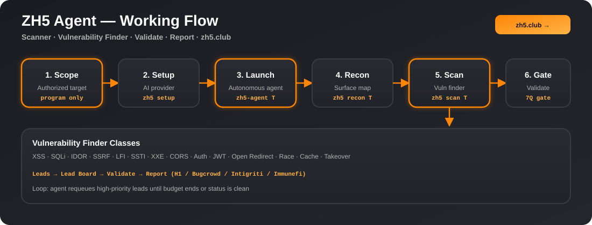

# ZH5 Agent

**Autonomous AI bug bounty hunter** by [ZH5](https://zh5.club) · [Tamilselvan-S-Cyber-Security](https://github.com/Tamilselvan-S-Cyber-Security)

[](https://zh5.club)
[](https://github.com/Tamilselvan-S-Cyber-Security/zh5-agent)

`zh5` — interactive CLI (recon / scan / validate / report)  
`zh5-agent` — autonomous session runner (scanner + vulnerability finder loop)

> **Authorized testing only.** Stay inside bug bounty program scope.

---

## Working flow

```text
 Scope → Setup → Launch → Recon → Scan (Vuln Finder) → Validate → Report
                              ↑________________loop (lead board)_________|
```



| Step | What happens | Command |
|:--|:--|:--|
| **1. Scope** | Confirm in-program / authorized target | — |
| **2. Setup** | Configure AI provider (Ollama / Groq / Claude / …) | `zh5 setup` |
| **3. Launch** | Start autonomous hunt session | `zh5-agent target.com` |
| **4. Recon** | Subdomains, endpoints, tech fingerprint | `zh5 recon target.com` |
| **5. Scan** | Vulnerability finder across classes + lead board | `zh5 scan target.com` |
| **6. Validate** | 7-Question Gate on candidates | `zh5 validate "finding"` |
| **7. Report** | Submission-ready notes | `zh5 report` |

### Vulnerability finder classes

XSS · SQLi · IDOR · SSRF · LFI · SSTI · XXE · CORS · Auth bypass · JWT · Open Redirect · Race conditions · Cache poisoning · Subdomain takeover · and more via skills / tools.

---

## Quick start

```bash
git clone https://github.com/Tamilselvan-S-Cyber-Security/zh5-agent
cd zh5-agent
./install.sh --agent standalone

zh5 setup
zh5-agent target.com
```

### Free local AI (optional)

```bash
curl -fsSL https://ollama.ai/install.sh | sh
ollama pull qwen2.5:14b
zh5 setup
```

---

## Commands

```bash
zh5-agent target.com          # autonomous scanner + vuln finder
zh5-agent target.com --quick  # lighter pass
zh5 help
zh5 setup
zh5 recon target.com
zh5 scan target.com           # full scan pipeline
zh5 validate "finding"
zh5 report
zh5 status
zh5 chat
zh5 mcp serve
```

Aliases: `hunt` / `h` → `zh5 scan`. Legacy `bughunter` binary kept after install.

---

## ZH5 Scan vs ZH5 Agent

| | **ZH5 Scan** (`zh5`) | **ZH5 Agent** (`zh5-agent`) |
|:--|:--|:--|
| Mode | Interactive, step-by-step | Autonomous session loop |
| Best for | Driving each phase yourself | Longer unattended hunt |
| Core | `zh5 scan target.com` | `zh5-agent target.com` |

Hub pages: [ZH5 Scan](../zh5-scan.html) · [ZH5 Agent](../zh5-agent.html) · [zh5.club](https://zh5.club)

---

## Install targets

```bash
./install.sh --agent standalone   # zh5 + zh5-agent on PATH
./install.sh --agent claude       # Claude Code plugin
./install.sh --agent mcp          # MCP server hints
./install.sh --agent all          # every supported target
```

---

## Links

- Website: [https://zh5.club](https://zh5.club)
- GitHub: [Tamilselvan-S-Cyber-Security/zh5-agent](https://github.com/Tamilselvan-S-Cyber-Security/zh5-agent)
- Flow SVG: [`docs/zh5-agent-flow.svg`](docs/zh5-agent-flow.svg)
- Uncensored local models companion: [`../uncensored-ai.html`](../uncensored-ai.html)

---

## License

MIT — see [LICENSE](LICENSE).
